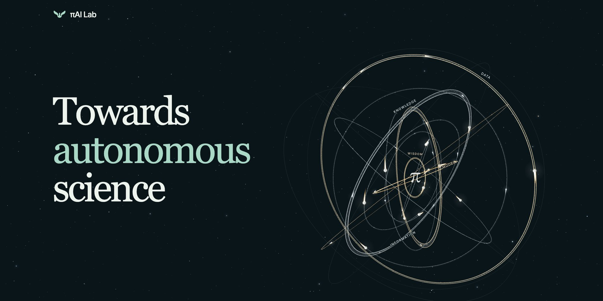
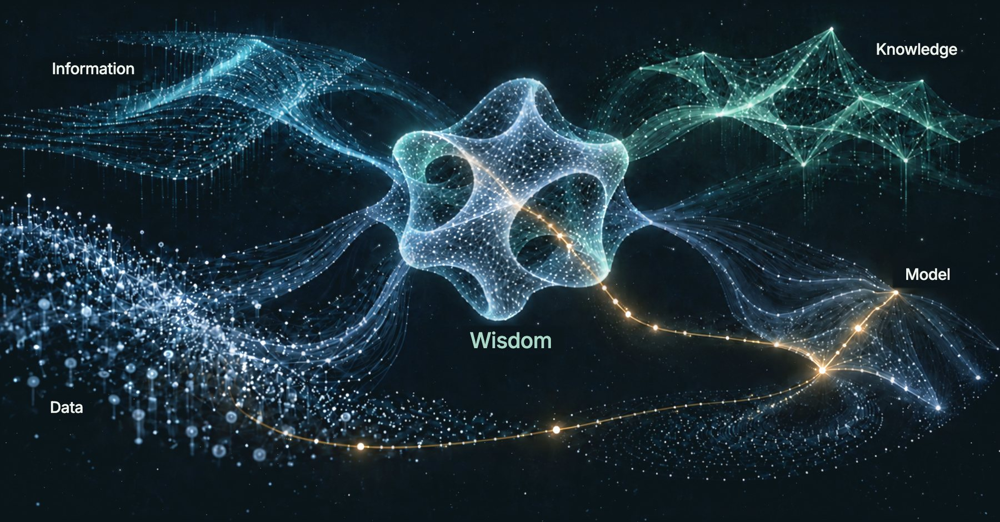
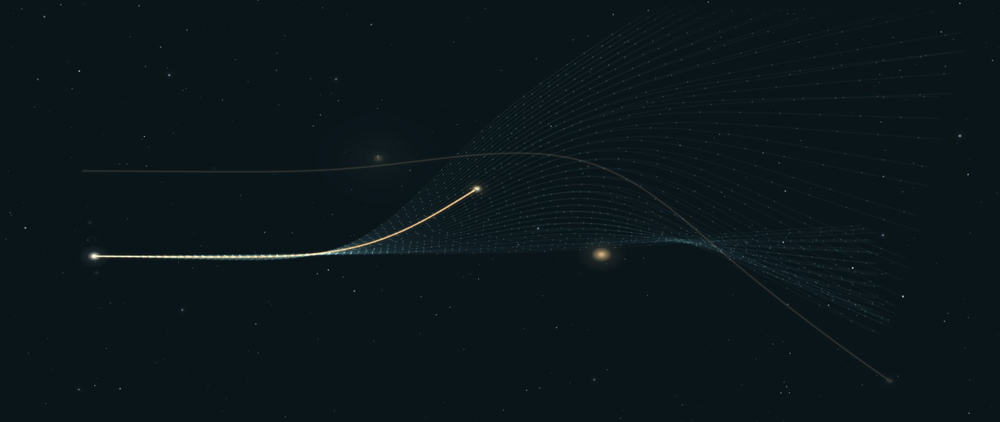
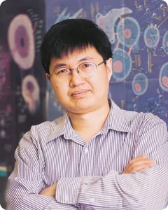
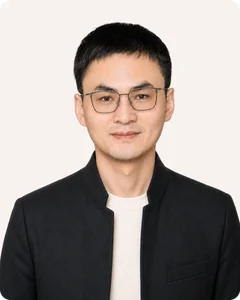
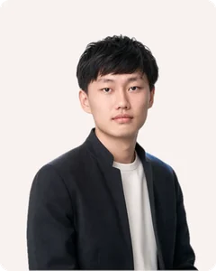
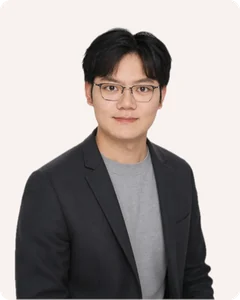

<a href="https://piai-lab.github.io/">
  <picture>
    <source media="(prefers-color-scheme: dark)" srcset="./assets/hero-dark.jpg">
    <source media="(prefers-color-scheme: light)" srcset="./assets/hero-light.jpg">
    
  </picture>
</a>

  <a href="https://piai-lab.github.io/"><b>Website</b></a>&emsp;·&emsp;<a href="#research">Research</a>&emsp;·&emsp;<a href="#news--events">News &amp; Events</a>&emsp;·&emsp;<a href="#team">Team</a>&emsp;·&emsp;<a href="mailto:liuzaoqu@163.com">Contact</a>&emsp;·&emsp;<a href="#中文">中文</a>

 

We build AI-ready scientific infrastructure and study agents that carry inquiry from hypothesis to evidence. Our work is meant for every field of science, and biomedicine is where we begin.

## Research

### AI-ready scientific infrastructure

We connect data, models, tools and knowledge so that agents can find, use and verify them, giving scientific reasoning, computation and validation common ground

<picture>
  <source media="(prefers-color-scheme: dark)" srcset="./assets/infrastructure-dark.jpg">
  <source media="(prefers-color-scheme: light)" srcset="./assets/infrastructure-light.jpg">
  
</picture>

### Autonomous scientific discovery

We study how agents can choose experiments, test predictions against evidence and revise their explanations, closing the loop of inquiry

<picture>
  <source media="(prefers-color-scheme: dark)" srcset="./assets/discovery-dark.jpg">
  <source media="(prefers-color-scheme: light)" srcset="./assets/discovery-light.jpg">
  
</picture>

## Platforms

  <a href="https://ai4snews.wisdomeyes.cn/en"><picture><source media="(prefers-color-scheme: dark)" srcset="./assets/platform-ai4s-news-dark.png"><source media="(prefers-color-scheme: light)" srcset="./assets/platform-ai4s-news-light.png"></picture></a>&emsp;&emsp;
  <a href="https://omnischolar.wisdomeyes.cn/"><picture><source media="(prefers-color-scheme: dark)" srcset="./assets/platform-omnischolar-dark.png"><source media="(prefers-color-scheme: light)" srcset="./assets/platform-omnischolar-light.png"></picture></a>&emsp;&emsp;
  <a href="https://omniknowledge.wisdomeyes.cn/"><picture><source media="(prefers-color-scheme: dark)" srcset="./assets/platform-omniknowledge-dark.png"><source media="(prefers-color-scheme: light)" srcset="./assets/platform-omniknowledge-light.png"></picture></a>&emsp;&emsp;
  <a href="https://euler.wisdomeyes.cn/"><picture><source media="(prefers-color-scheme: dark)" srcset="./assets/platform-euler-dark.png"><source media="(prefers-color-scheme: light)" srcset="./assets/platform-euler-light.png"></picture></a>

## News & Events

<table>
<tr><td valign="top" width="120"><code>2026.10.10</code></td><td><a href="https://omniknowledge.wisdomeyes.cn/"><b>OmniKnowledge released</b></a></td></tr>
<tr><td valign="top" width="120"><code>2026.09.20</code></td><td><a href="https://omnischolar.wisdomeyes.cn/"><b>OmniScholar released</b></a></td></tr>
<tr><td valign="top" width="120"><code>2026.09.18</code></td><td><b>PathWeaver submitted to ICLR 2027</b> Our work explores how explicit reasoning graphs can enhance diagnostic reasoning in pathology vision-language models</td></tr>
<tr><td valign="top" width="120"><code>2026.09.16</code></td><td><b>OmniFigure submitted to ICLR 2027</b> We explore a unified representation for data visualization, aiming to describe different visualization forms within a common framework</td></tr>
<tr><td valign="top" width="120"><code>2026.09.15</code></td><td><a href="https://ai4snews.wisdomeyes.cn/en"><b>AI4S News released</b></a></td></tr>
<tr><td valign="top" width="120"><code>2026.09.01</code></td><td><b>Founded πAI Lab</b> Advancing AI-ready scientific infrastructure and autonomous scientific discovery</td></tr>
</table>

## Team

<table>
<tr>
<td align="center" valign="top" width="20%"> <a href="https://www.pi-hub.org.cn/news/news/%2091"><b>Fuchu He</b></a> President, IAPM Academician of the Chinese Academy of Sciences</td>
<td align="center" valign="top" width="20%"> <a href="https://piai-lab.github.io/people/zaoqu-liu/"><b>Zaoqu Liu</b></a> Founder Biomedical Multimodal Large Model Scientist</td>
<td align="center" valign="top" width="20%"> <b>Ronghao Chen</b> AI Agent Systems Architect</td>
<td align="center" valign="top" width="20%"> <b>Yushuai Wu</b> Researcher</td>
<td align="center" valign="top" width="20%"> <b>Jingkuan Yang</b> Knowledge Discovery AI Engineer</td>
</tr>
<tr>
<td align="center" valign="top" width="20%"> <b>Zhihao Xu</b> Knowledge Discovery AI Engineer</td>
<td align="center" valign="top" width="20%"> <b>Mingyang Yan</b> AI Product &amp; Full-Stack Engineer</td>
<td align="center" valign="top" width="20%"> <b>Qiuran Ren</b> AI Algorithms &amp; Backend Engineer</td>
<td align="center" valign="top" width="20%"> <b>Wenjun Li</b> AI Platform Engineer</td>
<td align="center" valign="top" width="20%"> <b>Rongfeng Zheng</b> Knowledge Discovery AI Engineer</td>
</tr>
</table>

### Collaborators

<table>
<tr>
<td align="center" valign="top" width="33%"> <b>Jingping Liu</b> Associate Professor Sun Yat-sen University</td>
<td align="center" valign="top" width="33%"> <b>Qizhen Lan</b> Postdoctoral Researcher UTHealth Houston</td>
<td align="center" valign="top" width="33%"> <b>Huacan Wang</b> AI Agent Algorithm Lead Midea AI Research</td>
</tr>
<tr>
<td align="center" valign="top" width="33%"> <b>Yifan Zhou</b> Master's Student Shanghai Jiao Tong University</td>
<td align="center" valign="top" width="33%"> <b>Tingyu Wu</b> Master's Student Institute of Computing Technology, CAS</td>
<td align="center" valign="top" width="33%"> <b>Guangyu Cao</b> Master's Student Institute of Automation, CAS</td>
</tr>
</table>

## Open to collaboration

Academic exchange and joint research on scientific infrastructure, autonomous discovery and agent methods

**[liuzaoqu@163.com](mailto:liuzaoqu@163.com)**

 

<b>中文</b>

 

构建 AI-ready 科学基础设施，研究智能体如何从假设走向证据。πAI Lab 面向各个科学领域，以生物医学为切入点。

### 研究方向

**AI-ready 科学基础设施**

贯通数据、模型、工具与知识，让智能体能够查找、调用和核验，为科学推理、计算与验证提供共同基础

**自主科学发现**

研究智能体如何自主选择实验、用证据检验预测、修正解释，让科学探究形成闭环

### 平台

[AI4S News](https://ai4snews.wisdomeyes.cn/en)&emsp;·&emsp;[OmniScholar](https://omnischolar.wisdomeyes.cn/)&emsp;·&emsp;[OmniKnowledge](https://omniknowledge.wisdomeyes.cn/)&emsp;·&emsp;[Euler](https://euler.wisdomeyes.cn/)

### 新闻与动态

<table>
<tr><td valign="top" width="120"><code>2026.10.10</code></td><td><a href="https://omniknowledge.wisdomeyes.cn/"><b>OmniKnowledge 发布</b></a></td></tr>
<tr><td valign="top" width="120"><code>2026.09.20</code></td><td><a href="https://omnischolar.wisdomeyes.cn/"><b>OmniScholar 发布</b></a></td></tr>
<tr><td valign="top" width="120"><code>2026.09.18</code></td><td><b>PathWeaver 投稿 ICLR 2027</b> 探索显式推理图如何增强病理视觉语言模型的诊断推理</td></tr>
<tr><td valign="top" width="120"><code>2026.09.16</code></td><td><b>OmniFigure 投稿 ICLR 2027</b> 探索数据可视化的统一表示，在同一框架内描述不同的可视化形式</td></tr>
<tr><td valign="top" width="120"><code>2026.09.15</code></td><td><a href="https://ai4snews.wisdomeyes.cn/en"><b>AI4S News 发布</b></a></td></tr>
<tr><td valign="top" width="120"><code>2026.09.01</code></td><td><b>πAI Lab 成立</b> 推进 AI-ready 科学基础设施与自主科学发现</td></tr>
</table>

### 团队成员

<table>
<tr>
<td align="center" valign="top" width="20%"> <a href="https://www.pi-hub.org.cn/news/news/%2091"><b>贺福初</b></a> Fuchu He 广东智慧医学 国际研究院院长 中国科学院院士</td>
<td align="center" valign="top" width="20%"> <a href="https://piai-lab.github.io/people/zaoqu-liu/?lang=zh"><b>刘灶渠</b></a> Zaoqu Liu 创始人 生物医学多模态 大模型科学家</td>
<td align="center" valign="top" width="20%"> <b>陈镕浩</b> Ronghao Chen AI 智能体系统架构师</td>
<td align="center" valign="top" width="20%"> <b>吴俣帅</b> Yushuai Wu 研究员</td>
<td align="center" valign="top" width="20%"> <b>杨靖宽</b> Jingkuan Yang 知识发现 AI 工程师</td>
</tr>
<tr>
<td align="center" valign="top" width="20%"> <b>徐志豪</b> Zhihao Xu 知识发现 AI 工程师</td>
<td align="center" valign="top" width="20%"> <b>闫明阳</b> Mingyang Yan AI 产品与全栈工程师</td>
<td align="center" valign="top" width="20%"> <b>任秋燃</b> Qiuran Ren AI 算法与后端工程师</td>
<td align="center" valign="top" width="20%"> <b>李文俊</b> Wenjun Li AI 平台工程师</td>
<td align="center" valign="top" width="20%"> <b>郑蓉峰</b> Rongfeng Zheng 知识发现 AI 工程师</td>
</tr>
</table>

### 合作者

<table>
<tr>
<td align="center" valign="top" width="33%"> <b>刘井平</b> Jingping Liu 中山大学 副教授</td>
<td align="center" valign="top" width="33%"> <b>兰启臻</b> Qizhen Lan 德克萨斯大学 休斯顿健康科学中心 博士后研究员</td>
<td align="center" valign="top" width="33%"> <b>汪华灿</b> Huacan Wang 美的 AI 研究院 AI Agent 算法负责人</td>
</tr>
<tr>
<td align="center" valign="top" width="33%"> <b>周奕帆</b> Yifan Zhou 上海交通大学 硕士生</td>
<td align="center" valign="top" width="33%"> <b>吴挺煜</b> Tingyu Wu 中国科学院计算技术研究所 硕士生</td>
<td align="center" valign="top" width="33%"> <b>曹广雨</b> Guangyu Cao 中国科学院自动化研究所 硕士生</td>
</tr>
</table>

### 欢迎研究合作

围绕科学基础设施、自主发现与智能体方法，开展学术交流与联合研究

**[liuzaoqu@163.com](mailto:liuzaoqu@163.com)**

---

Unless a repository states otherwise, public work in this organization is research-stage and does not represent production, clinical, legal or regulatory validation&emsp;·&emsp;<a href="../GOVERNANCE.md">Governance</a> · <a href="../PROJECT_POLICY.md">Project policy</a> · <a href="../CONTRIBUTING.md">Contributing</a> · <a href="../SECURITY.md">Security</a> · <a href="../SUPPORT.md">Support</a>
